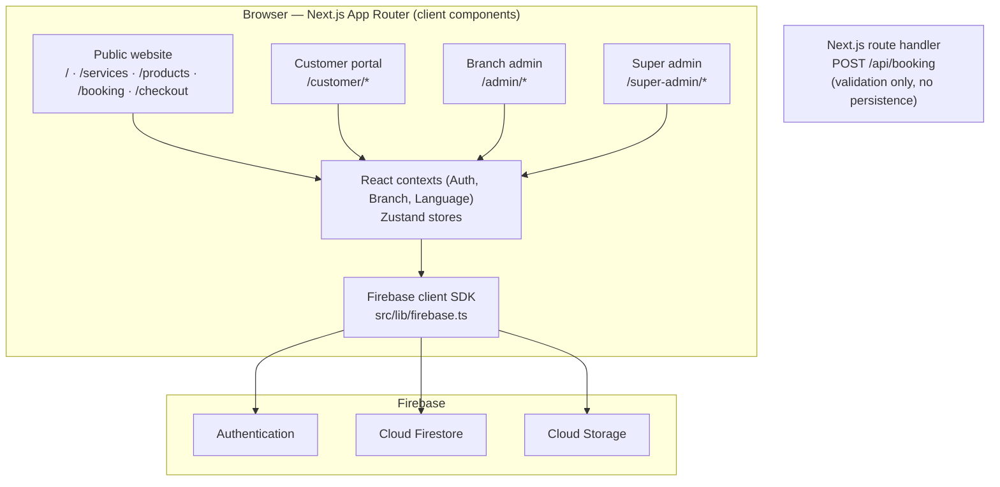

<p align="center">
  
</p>

<h1 align="center">Man of Cave</h1>

<p align="center">
  A multi-branch barbershop and grooming management platform that combines a public booking website,
  a customer self-service portal, branch administration dashboards and a business-wide super-administrator console
  in a single Next.js application.
</p>

<p align="center">
  <strong>Next.js 16</strong> · <strong>React 19</strong> · <strong>TypeScript</strong> · <strong>Firebase</strong> · <strong>Tailwind CSS 4</strong> · <strong>shadcn/ui</strong> · <strong>Zustand</strong>
</p>

---

## Table of Contents

- [Overview](#overview)
- [Key Features](#key-features)
- [Technology Stack](#technology-stack)
- [Architecture](#architecture)
- [Application Routes](#application-routes)
- [Project Structure](#project-structure)
- [Getting Started](#getting-started)
- [Configuration](#configuration)
- [Firestore Data Model](#firestore-data-model)
- [Available Scripts](#available-scripts)
- [Production Build and Deployment](#production-build-and-deployment)
- [Project Status and Limitations](#project-status-and-limitations)
- [License](#license)

## Overview

Grooming businesses that operate several branches typically juggle separate tools for online bookings, point-of-sale, staff scheduling, customer loyalty and reporting. **Man of Cave** brings these workflows together in one web application backed by Firebase.

The platform serves three audiences:

| Role | Experience |
| --- | --- |
| **Customer** | Browses services, products and branches; books appointments; checks out product orders; and manages bookings, orders, loyalty points, wallet and profile from a personal portal. |
| **Branch admin** (`admin`) | Runs daily operations for an assigned branch — appointments, the booking calendar, clients, staff, catalogue, orders, expenses, invoices and customer communication. |
| **Super admin** (`super_admin`) | Oversees the entire business across all branches — branch and user management, cross-branch reporting, finance, staff attendance, memberships and blog content. |

## Key Features

### Public Website and Discovery
- Landing page, service catalogue, product catalogue and services menu
- Branch directory with individual branch detail pages
- Blog with article pages, managed from the super-admin console

### Booking and Checkout
- Appointment booking with branch, service, staff, date and time selection
- Product cart and checkout supporting Cash on Delivery, digital wallet and mixed payments (wallet and mixed payments require a signed-in customer)

### Customer Portal
- Email and password registration and sign-in via Firebase Authentication
- Booking, order and transaction history
- Loyalty points and wallet balance
- Profile management and live chat with the branch team

### Branch Administration
- Appointment management and an interactive booking calendar with PDF export
- Management of clients, staff, services, categories, products, orders and memberships
- Expense tracking with charts
- Custom invoice generation with PDF export
- Branch analytics and settings, including display currency selection (USD, INR, PKR, AED)

### Super-Administrator Controls
- Branch management and user management with role assignment and per-user page permissions (`allowedPages`)
- Cross-branch appointments, booking calendar, clients, staff, products, orders and memberships
- Financial management, booking reports and order finance reports
- Analytics with Excel (`.xlsx`) export
- Blog publishing and global settings with file uploads to Firebase Storage

### Communication and Operations
- Staff attendance tracking
- Real-time customer chat, internal admin/branch messaging and customer feedback
- Audible notifications for incoming messages on admin dashboards

## Technology Stack

| Purpose | Technologies |
| --- | --- |
| Framework | [Next.js 16](https://nextjs.org/) (App Router), [React 19](https://react.dev/) |
| Language | [TypeScript 5](https://www.typescriptlang.org/) (strict mode) |
| Backend services | [Firebase](https://firebase.google.com/) — Authentication, Cloud Firestore, Cloud Storage, Analytics |
| UI and styling | [Tailwind CSS 4](https://tailwindcss.com/), [shadcn/ui](https://ui.shadcn.com/) on [Radix UI](https://www.radix-ui.com/), [Lucide](https://lucide.dev/) icons, Sonner toasts, Embla Carousel |
| State management | [Zustand](https://zustand.docs.pmnd.rs/) |
| Forms and validation | [React Hook Form](https://react-hook-form.com/), [Zod](https://zod.dev/) |
| Dates and scheduling | date-fns, React Day Picker, React Datepicker |
| Charts and exports | [Recharts](https://recharts.org/), jsPDF with jsPDF-AutoTable (PDF), SheetJS `xlsx` (Excel) |
| Code quality | ESLint 9 with `eslint-config-next` |

## Architecture

Man of Cave is a **Next.js App Router application that talks to Firebase directly from the browser**. There is no separate backend server: pages, React contexts and Zustand stores use the Firebase client SDK to authenticate users and read and write Cloud Firestore and Cloud Storage.



**Key design points**

- **Client-side Firebase access** — all application data flows through the Firebase client SDK initialised in [`src/lib/firebase.ts`](src/lib/firebase.ts), which exports `auth`, `db`, `storage` and `analytics`.
- **Authentication and roles** — `AuthContext` listens to Firebase Auth state and loads the signed-in user's profile from the `users` collection, including `role`, `branchId` and `allowedPages`.
- **Route protection** — dashboard pages are wrapped in a client-side `ProtectedRoute` component that redirects unauthenticated users to `/login` and blocks branch admins from `/super-admin` routes.
- **Branch scoping** — `BranchContext` and the branch stores scope data to the active branch.
- **Internationalisation** — `LanguageContext` provides an English/Arabic translation dictionary and switches the document direction to right-to-left for Arabic.
- **API route** — the only server-side route handler, `app/api/booking/route.ts`, validates booking payloads and returns a generated booking ID. It does not persist data; bookings made in the application are stored in Firestore by the client.

## Application Routes

| Area | Routes |
| --- | --- |
| **Public** | `/` · `/services` · `/products` · `/menu` · `/branches` · `/branches/[id]` · `/blog` · `/blog/[slug]` · `/booking` · `/checkout` |
| **Customer** | `/customer/login` · `/customer/chat` · `/customer/portal` · `/customer/portal/bookings` · `/customer/portal/orders` · `/customer/portal/transactions` · `/customer/portal/loyalty` · `/customer/portal/profile` |
| **Staff sign-in** | `/login` |
| **Branch admin** | `/admin` · `/admin/appointments` · `/admin/bookingcalender` · `/admin/clients` · `/admin/staff` · `/admin/services` · `/admin/categories` · `/admin/products` · `/admin/orders` · `/admin/membership` · `/admin/expenses` · `/admin/custominvoice` · `/admin/customer-chats` · `/admin/messages` · `/admin/feedbacks` · `/admin/branches` · `/admin/analytics` · `/admin/settings` |
| **Super admin** | `/super-admin` · `/super-admin/branches` · `/super-admin/branches-management` · `/super-admin/users` · `/super-admin/appointments` · `/super-admin/bookingcalender` · `/super-admin/clients` · `/super-admin/staff` · `/super-admin/attendance` · `/super-admin/services` · `/super-admin/categories` · `/super-admin/products` · `/super-admin/orders` · `/super-admin/membership` · `/super-admin/financial` · `/super-admin/sales` · `/super-admin/report` · `/super-admin/analytics` · `/super-admin/expenses` · `/super-admin/custom-invoice` · `/super-admin/blogs` · `/super-admin/customer-chat` · `/super-admin/messages` · `/super-admin/feedback` · `/super-admin/settings` |
| **Other screens** | `/cms` (landing page CMS) · `/mobile-app` (mobile app management) |
| **API** | `POST /api/booking` |

> Route names reflect the directory names in `app/`, including `bookingcalender`.

## Project Structure

```text
manofcave/
├── app/                        # Next.js App Router
│   ├── layout.tsx              # Root layout and providers
│   ├── page.tsx                # Landing page
│   ├── globals.css             # Tailwind CSS and theme variables
│   ├── admin/                  # Branch admin dashboard
│   ├── super-admin/            # Super-administrator console
│   ├── customer/               # Customer login, chat and portal
│   ├── api/booking/route.ts    # Booking validation route handler
│   ├── blog/  booking/  branches/  checkout/  menu/  products/  services/
│   ├── login/                  # Staff sign-in
│   ├── cms/                    # Landing page CMS screen
│   └── mobile-app/             # Mobile app management screen
├── src/
│   ├── components/
│   │   ├── ui/                 # shadcn/ui primitives and custom calendar
│   │   ├── admin/              # Dashboard sidebar and admin components
│   │   ├── booking/            # Booking components
│   │   ├── shared/             # Header and Footer
│   │   ├── ProtectedRoute.tsx  # Client-side role guard
│   │   └── providers.tsx       # Context providers
│   ├── contexts/               # Auth, Branch, CustomerAuth and Language contexts
│   ├── hooks/                  # Message notification and toast hooks
│   ├── lib/                    # Firebase initialisation, messaging and invoice utilities
│   └── stores/                 # Zustand stores (bookings, branches, services, staff, ...)
├── types/                      # Shared TypeScript types
├── public/                     # Logos, notification sound and icons
├── components.json             # shadcn/ui configuration
├── next.config.ts              # Next.js configuration (remote image hosts)
├── tsconfig.json               # TypeScript configuration and @/* path alias
└── package.json
```

## Getting Started

### Prerequisites

- **Node.js 20.9.0 or later** — the minimum version required by Next.js 16
- **npm** — the repository includes a `package-lock.json`
- **A Firebase project** with Authentication (Email/Password provider), Cloud Firestore and Cloud Storage enabled, if you intend to run against your own backend

### Installation

```bash
git clone https://github.com/faiza-ijaz0/manofcave.git
cd manofcave
npm install
```

### Run Locally

```bash
npm run dev
```

The development server starts at [http://localhost:3000](http://localhost:3000).

- Public website: `http://localhost:3000`
- Customer sign-in and registration: `http://localhost:3000/customer/login`
- Staff sign-in: `http://localhost:3000/login`, which leads to `/admin` or `/super-admin` depending on the account's role

## Configuration

### Firebase

Firebase is initialised in [`src/lib/firebase.ts`](src/lib/firebase.ts) from a `firebaseConfig` object containing the standard web app fields (`apiKey`, `authDomain`, `projectId`, `storageBucket`, `messagingSenderId`, `appId`, `measurementId`).

**Environment variables are not currently used.** The configuration values are defined directly in that file, and no `.env` file is required to run the project.

To point the application at your own Firebase project:

1. In the Firebase Console, create a project and register a **Web app**.
2. Enable **Authentication → Email/Password**, **Cloud Firestore** and **Cloud Storage**.
3. Replace the values in `firebaseConfig` in `src/lib/firebase.ts` with your web app's configuration.

### Remote Images

[`next.config.ts`](next.config.ts) allows `next/image` to load images from `images.unsplash.com`, `images.pexels.com` and `encrypted-tbn0.gstatic.com`. Add hosts to `images.remotePatterns` as required.

### Path Alias

`@/*` resolves to `src/*` (configured in [`tsconfig.json`](tsconfig.json)), for example `import { db } from '@/lib/firebase'`.

## Firestore Data Model

Collections are created on first write, so no migration step is required. The main collections referenced in the source are:

| Domain | Collections | Purpose |
| --- | --- | --- |
| Identity and access | `users`, `customers` | Staff profiles with `role`, `branchId` and `allowedPages`; customer records |
| Branches and catalogue | `branches`, `services`, `categories`, `products`, `staff` | Locations, service and product catalogue, team members |
| Bookings and sales | `bookings`, `orders`, `cart`, `transactions`, `customInvoices` | Appointments, product orders, payments and invoices |
| Loyalty and payments | `loyaltyPoints`, `loyalty_settings`, `wallets`, `walletTransactions`, `cashbackPrograms`, `memberships`, `offers`, `promoCodes` | Rewards, wallet balances, memberships and promotions |
| Messaging | `conversations`, `customerMessages`, `customerReplies`, `adminMessages`, `branchMessages` | Customer chat and internal messaging |
| Operations and content | `attendance`, `manualExpenses`, `feedbacks`, `blogs` | Staff attendance, expenses, customer feedback and blog posts |

### First-Time Setup

Staff permissions are read from the `users` collection, keyed by Firebase Auth UID. To create the first staff account:

1. Create the user under **Firebase Console → Authentication**.
2. In Firestore, add a document to `users` with the user's UID as the document ID and these fields:
   - `role` — `"super_admin"` or `"admin"`
   - `name` — display name
   - `branchId` and `branchName` — for branch admins
   - `allowedPages` — optional array of permitted dashboard pages
3. Sign in at `/login`.

Customers register themselves at `/customer/login`.

## Available Scripts

| Command | Purpose |
| --- | --- |
| `npm run dev` | Start the Next.js development server on port 3000 |
| `npm run build` | Create an optimised production build |
| `npm run start` | Serve the production build (run `npm run build` first) |
| `npm run lint` | Run ESLint across the project |

**No automated test suite is configured** in this repository.

## Production Build and Deployment

Build and serve the application locally in production mode:

```bash
npm run build
npm run start
```

The project uses a standard Next.js setup and can be hosted on any platform that supports Next.js. The repository does not include a deployment configuration or a verified live deployment.

**Vercel**

1. Import the GitHub repository into Vercel.
2. Keep the detected framework preset (**Next.js**) and the default build command (`npm run build`).
3. Deploy.

**Self-hosted Node.js**

```bash
npm ci
npm run build
npm run start   # listens on port 3000 by default; set PORT to override
```

After deploying, add the production domain under **Firebase Console → Authentication → Settings → Authorized domains** so that sign-in works on the hosted site.

## Project Status and Limitations

The application is under active development. Developers should be aware of the following:

- **Placeholder screens** — `/cms` and `/mobile-app` render static mock content and are not connected to Firestore.
- **Locally stored data** — `/super-admin/branches-management` uses a Zustand store seeded with sample branches rather than Firestore, and `/customer/portal/transactions` reads from a browser-persisted Zustand store.
- **Booking API** — `POST /api/booking` validates requests and returns a booking ID but does not persist anything.
- **Client-side access control** — role checks run in the browser through `ProtectedRoute`; there is no server-side middleware. Firestore and Storage security rules are not included in this repository.
- **Configuration in source** — Firebase settings are defined in `src/lib/firebase.ts` rather than environment variables.
- **Language support** — the English/Arabic translation context and RTL switching are in place, but page content does not yet consume the translation dictionary and no language switcher is exposed in the UI.
- **Testing** — there are no automated tests.

## License

No license file is included in this repository. All rights are reserved by the author unless a license is added.
